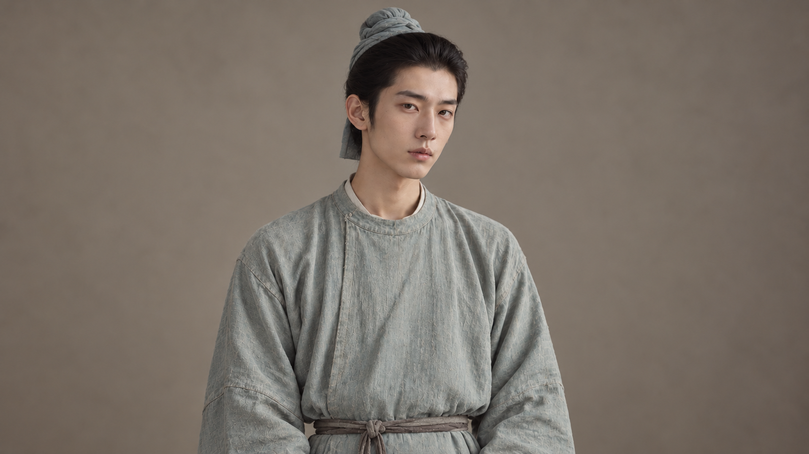
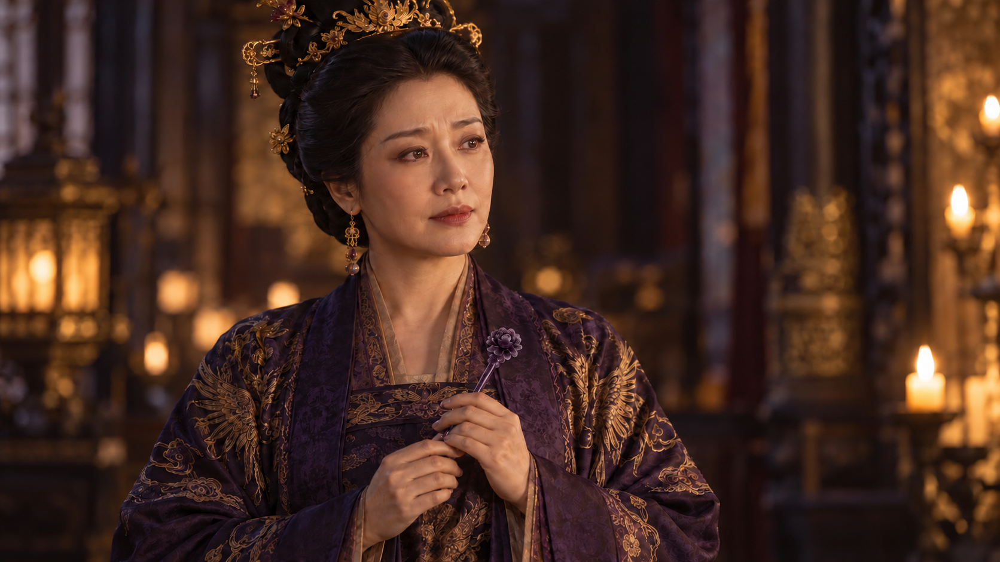
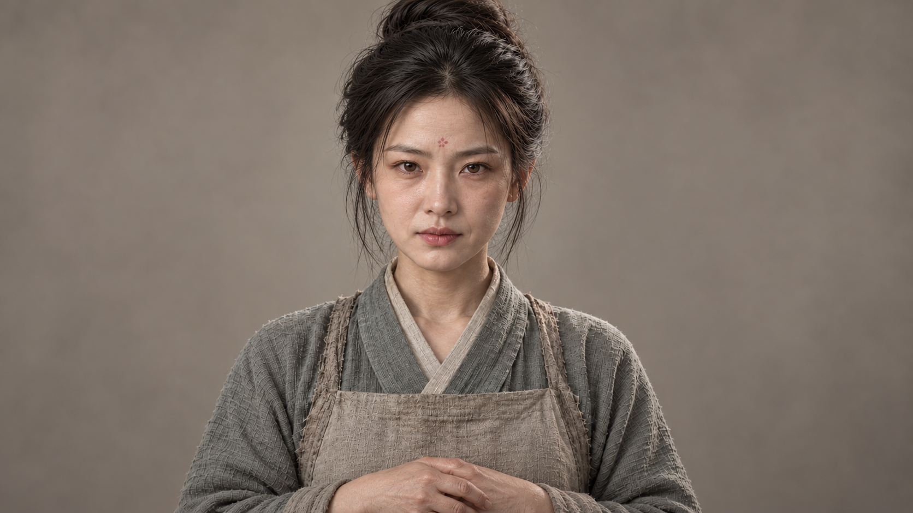
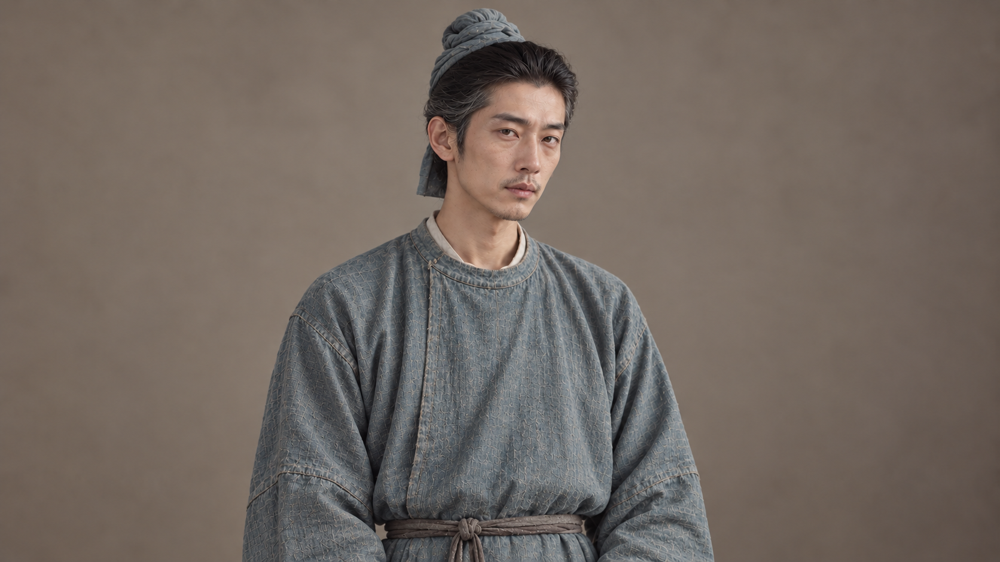
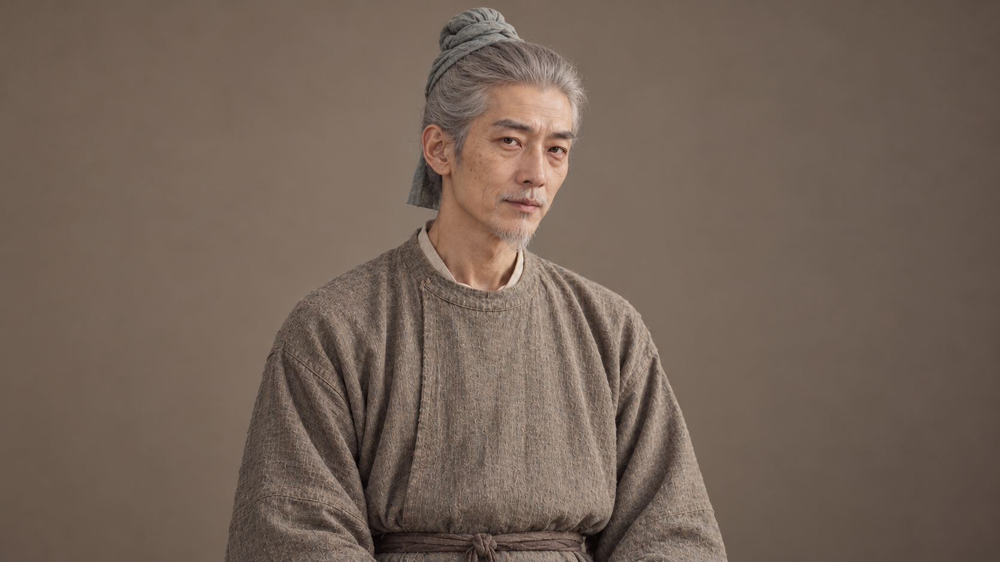

# 《第三种结局》角色定妆图 · 第二版

依据本次上传工作簿“角色定妆”表的“当前定妆图评估与处理”及修改记录第16–21项调整。

[下载新版完整包：10张人物图＋1张紫玉钗道具图](character_references_v2.zip)

本版采用单人半身构图，可直接用于角色参考，避免双视图导致模型生成两个人。前版保留在上一级目录。

## 文件与修改说明

| 角色/道具 | 图片 | 本版处理 |
| --- | --- | --- |
| 年轻小玉 | [xiaoyu_young_ref.png](xiaoyu_young_ref.png) | 重做：单人、放松眉头与表情 |
| 宫中小玉 | [xiaoyu_palace_ref.png](xiaoyu_palace_ref.png) | 重做：去掉紫玉钗，单人宫装 |
| 年轻沈十郎 | [shilang_ref.png](shilang_ref.png) | 重做：青布巾包髻、洗白浅青圆领袍、细布带 |
| 皇后 | [empress_ref.png](empress_ref.png) | 修改：参照新道具图替换牡丹玉钗并加深紫色 |
| 四皇子 | [prince4_ref.png](prince4_ref.png) | 沿用：工作簿标为可用，未添加可选玉佩纹样 |
| 卖鱼阿婶 | [aunt_ref.png](aunt_ref.png) | 沿用：工作簿标为可用 |
| 老妇小玉 | [xiaoyu_elder_ref.png](xiaoyu_elder_ref.png) | 重做：沿用年轻脸部参考、保留花钿、银白发髻 |
| 中年小玉 | [xiaoyu_middle_ref.png](xiaoyu_middle_ref.png) | 重做：沿用年轻脸部参考、恢复淡花钿 |
| 中年十郎 | [shilang_middle_ref.png](shilang_middle_ref.png) | 重做：以新版年轻十郎为参考、鬓白短须、青蓝圆领袍 |
| 老年十郎 | [shilang_elder_ref.png](shilang_elder_ref.png) | 重做：以新版年轻十郎为参考、灰白发、灰褐圆领袍 |
| 深紫牡丹玉钗 | [hairpin_ref.png](hairpin_ref.png) | 新增：深紫天然玉质、细钗杆、小牡丹钗头 |

## 分镜使用要点

- 宫中小玉基础图没有紫玉钗；M03由皇后簪上，后续使用 hairpin_ref.png 作为道具参考。
- M04–M20小玉佩戴同一支深紫牡丹玉钗；M21当掉，此后的非回忆镜头不再佩戴。
- 十郎各年龄阶段均以新版年轻十郎为面部参考，保持布巾包髻、圆领布袍、细布带；不使用前版长散发与交领造型。
- 小玉各年龄阶段均以新版年轻小玉为面部参考；中老年保留淡花钿。
- 四皇子与卖鱼阿婶沿用前版可用图。
- PNG为生成原图，约16:9横幅；后续镜头仍需检查五官、发饰与道具连续性。

## 图片预览

### 年轻小玉

### 宫中小玉

### 年轻沈十郎

### 皇后

### 四皇子

### 卖鱼阿婶

### 老妇小玉

### 中年小玉

### 中年十郎

### 老年十郎

### 深紫牡丹玉钗

