# 《第三种结局》定妆修订 · 第三版

本版依据第二版审阅意见修订：皇后牡丹钗头与玉叶；中年小玉年龄、衣色、鬓发；十郎素布袍与中年鬓白；补独立侧脸参考及四皇子牡丹玉佩可选版。

[下载第三版完整包（14张PNG）](character_references_v3.zip)

包含10张人物基础图、1张玉钗道具图、2张独立侧脸参考、1张四皇子玉佩可选图。保留前两版。

## 本版文件

| 角色/道具 | 文件 | 处理 |
| --- | --- | --- |
| 年轻小玉 | [xiaoyu_young_ref.png](xiaoyu_young_ref.png) | 沿用第二版已通过图 |
| 宫中小玉 | [xiaoyu_palace_ref.png](xiaoyu_palace_ref.png) | 沿用第二版已通过图 |
| 年轻沈十郎 | [shilang_ref.png](shilang_ref.png) | 以独立头部身份参考重做素色麻布圆领袍 |
| 皇后 | [empress_ref.png](empress_ref.png) | 参照道具图重绘手中层叠牡丹钗头与玉叶 |
| 四皇子（原版） | [prince4_ref.png](prince4_ref.png) | 沿用已通过原版，不替换为可选玉佩图 |
| 卖鱼阿婶 | [aunt_ref.png](aunt_ref.png) | 沿用第二版已通过图 |
| 老妇小玉 | [xiaoyu_elder_ref.png](xiaoyu_elder_ref.png) | 沿用第二版已通过图 |
| 中年小玉 | [xiaoyu_middle_ref.png](xiaoyu_middle_ref.png) | 褐色旧衣、整齐盘髻、鬓白、淡花钿、强化岁月痕迹 |
| 中年十郎 | [shilang_middle_ref.png](shilang_middle_ref.png) | 重做素色青蓝麻布圆领袍，保留鬓角白发与短须 |
| 老年十郎 | [shilang_elder_ref.png](shilang_elder_ref.png) | 重做素色灰褐麻布圆领袍，保留老年脸部参考 |
| 深紫牡丹玉钗 | [hairpin_ref.png](hairpin_ref.png) | 沿用已通过道具图，后续镜头的道具基准 |
| 年轻小玉侧脸 | [xiaoyu_young_side_ref.png](xiaoyu_young_side_ref.png) | 新增单人独立侧脸参考 |
| 年轻十郎侧脸 | [shilang_side_ref.png](shilang_side_ref.png) | 新增单人独立侧脸参考，素色麻布袍 |
| 四皇子牡丹玉佩（可选） | [prince4_peony_optional_ref.png](prince4_peony_optional_ref.png) | 可选版本：腰间增加牡丹纹玉佩，正式原版仍保留 |

## 使用说明

- 皇后持钗图已按 hairpin_ref.png 调整牡丹花头和玉叶；M03手部特写同时引用两图，重点复核花叶轮廓、比例及握持。
- 中年小玉仅用于M35–M37；年轻、宫中与老妇小玉沿用已通过第二版。
- 十郎使用本目录新版素布袍，避免再引用前两版带提花的整幅人物图。
- 两张侧脸图为独立参考，不能与正面拼接为一张输入图。
- 四皇子默认使用 prince4_ref.png；prince4_peony_optional_ref.png 为可选牡丹纹玉佩版本，如选用，相关镜头应统一。
- 生成图片不替代逐镜检查：后续需继续检查脸部身份、头饰、衣料及道具连续性。

## 图片预览

### 年轻小玉

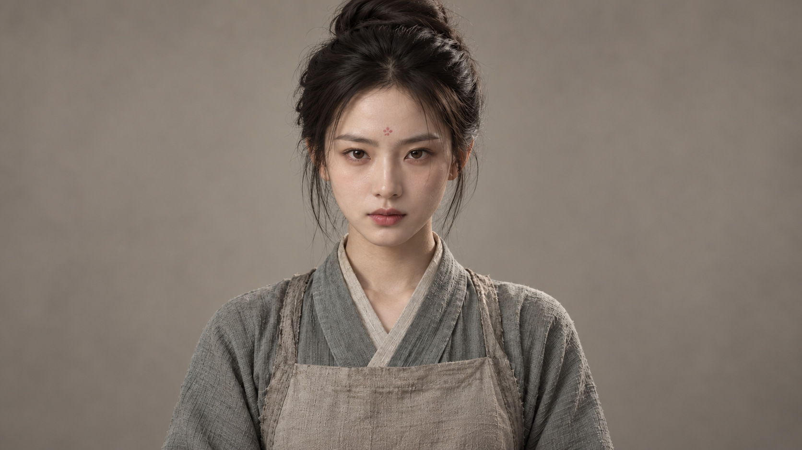

### 宫中小玉

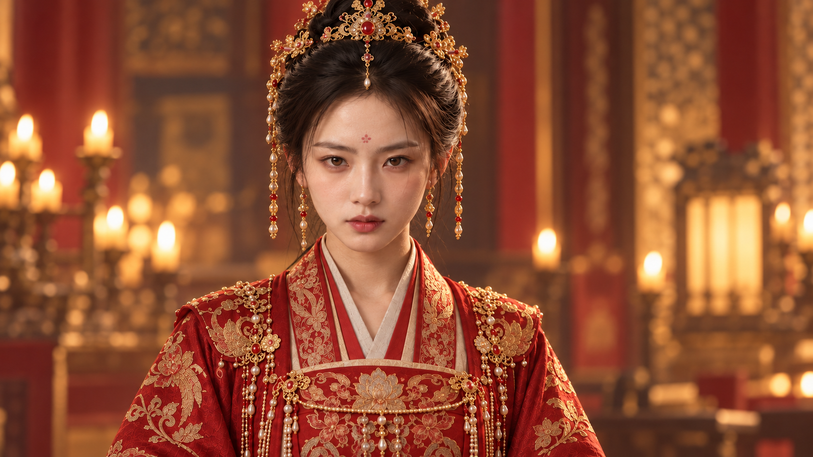

### 年轻沈十郎

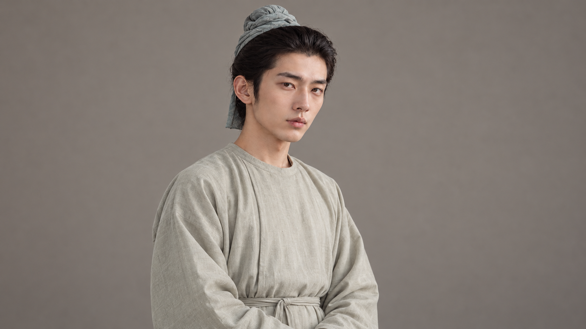

### 皇后

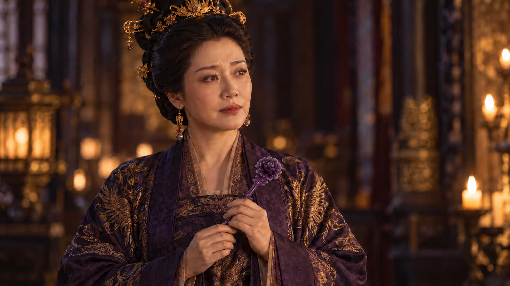

### 四皇子（原版）

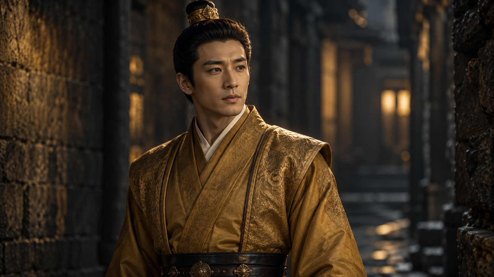

### 卖鱼阿婶

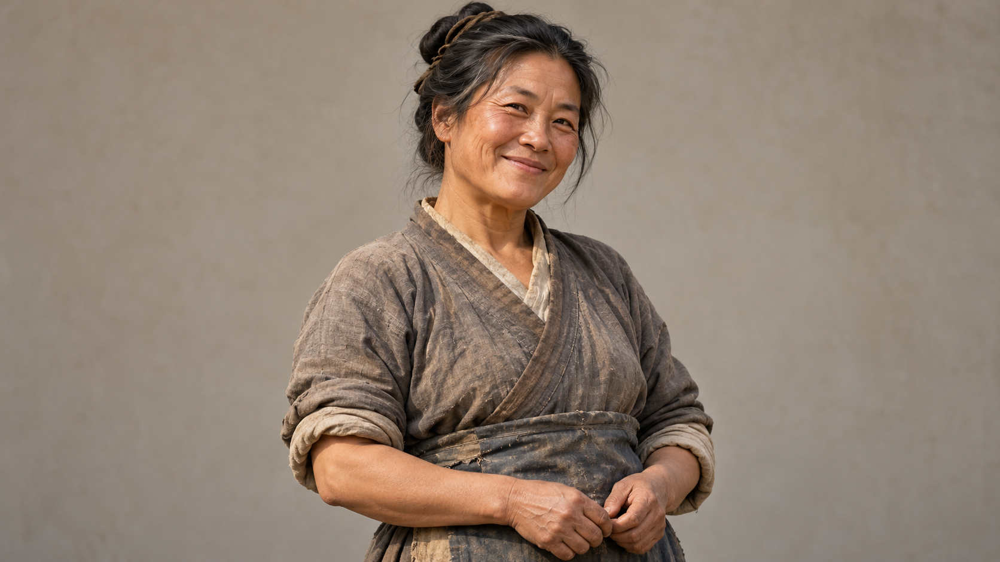

### 老妇小玉

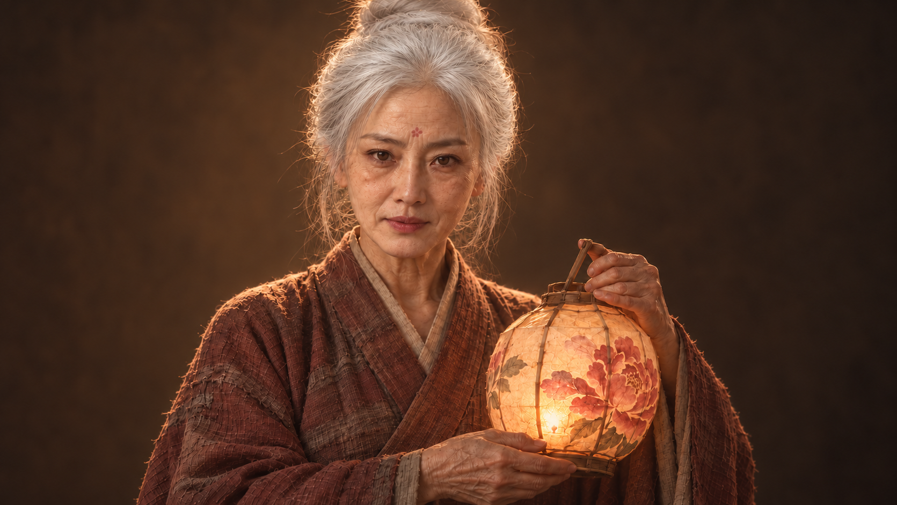

### 中年小玉

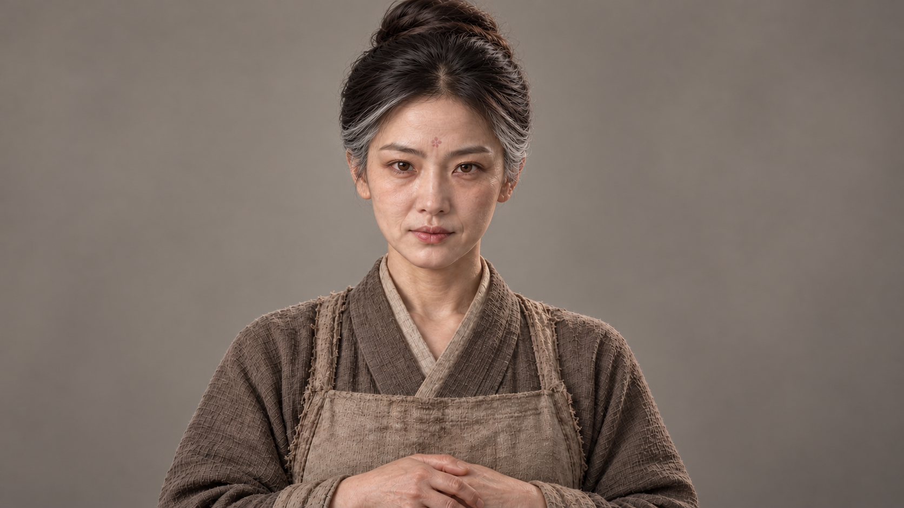

### 中年十郎

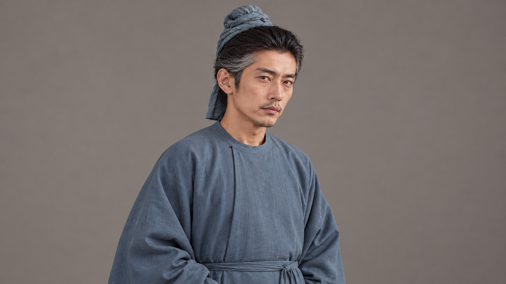

### 老年十郎

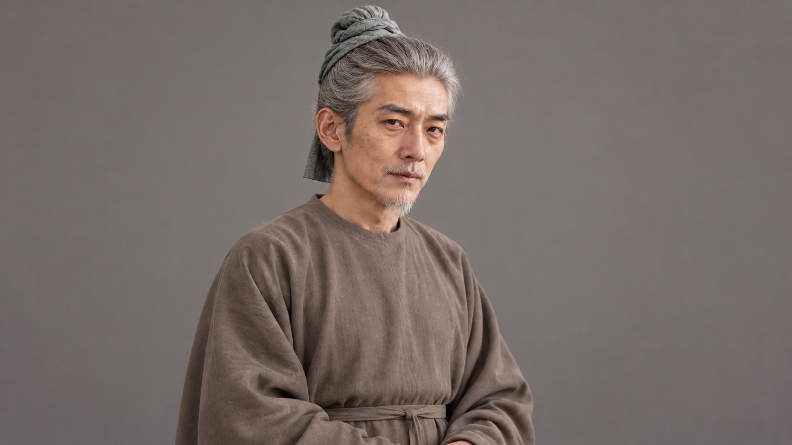

### 深紫牡丹玉钗

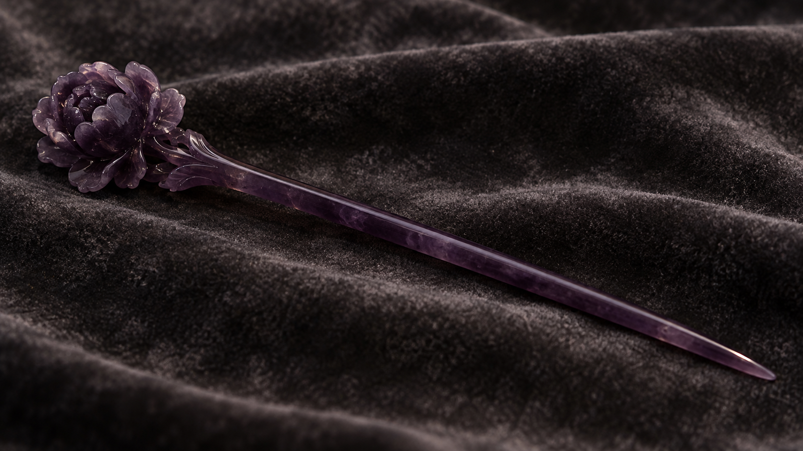

### 年轻小玉侧脸

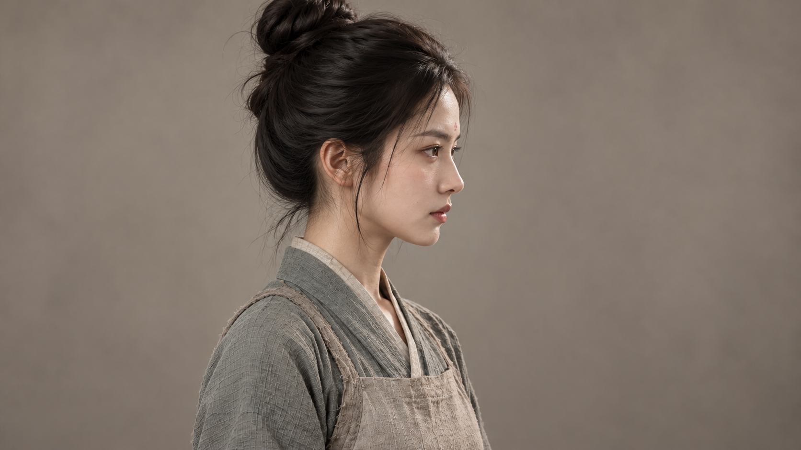

### 年轻十郎侧脸

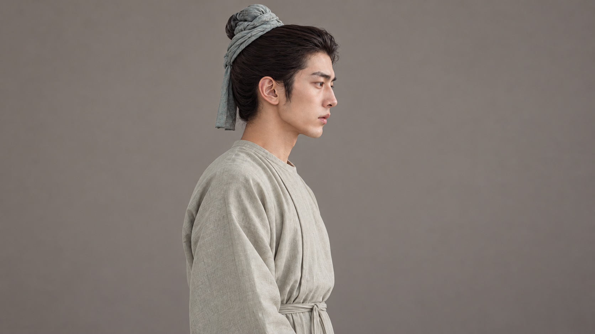

### 四皇子牡丹玉佩（可选）

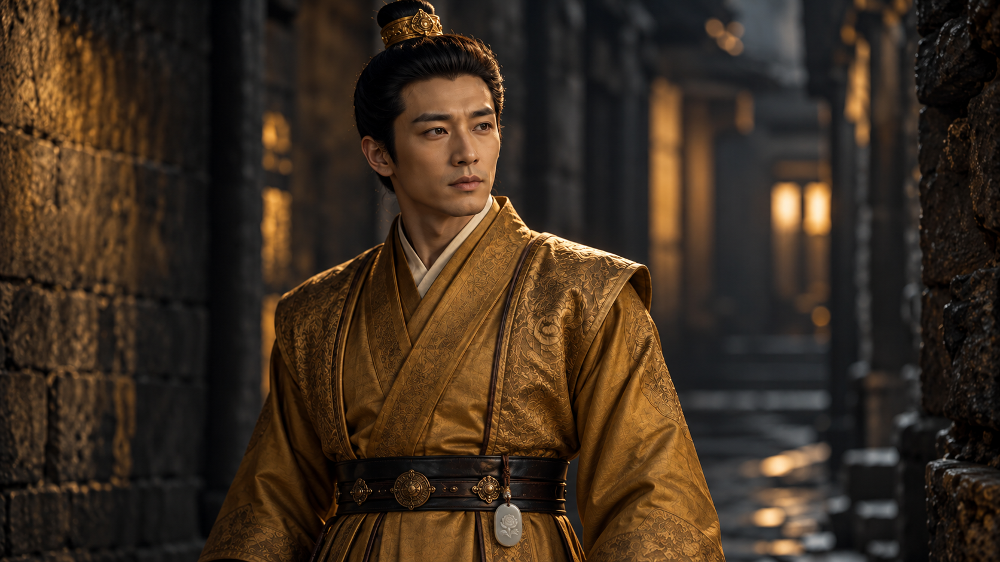
